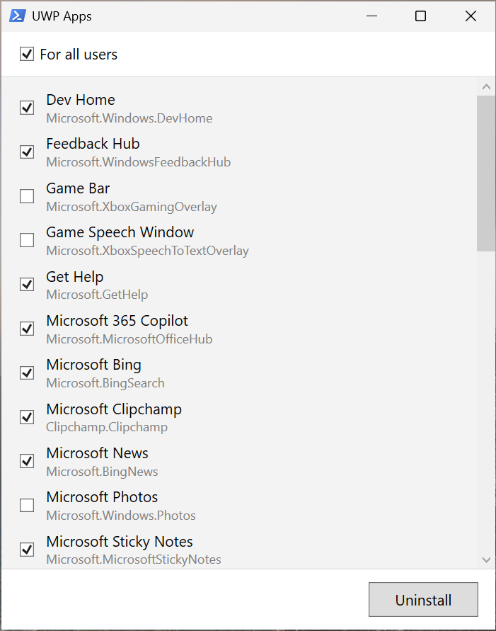
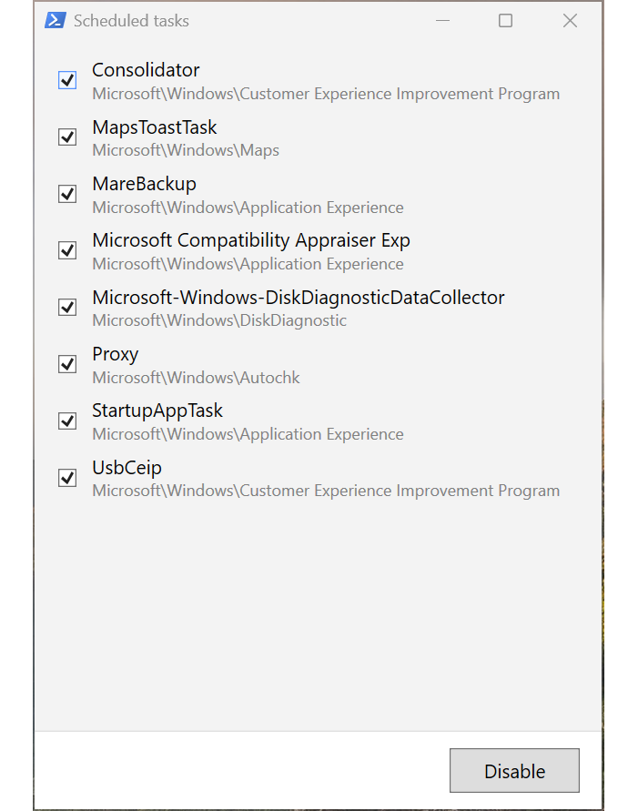
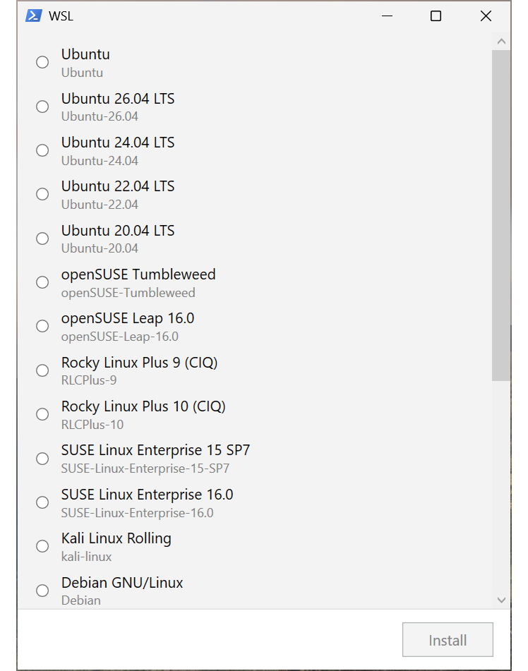
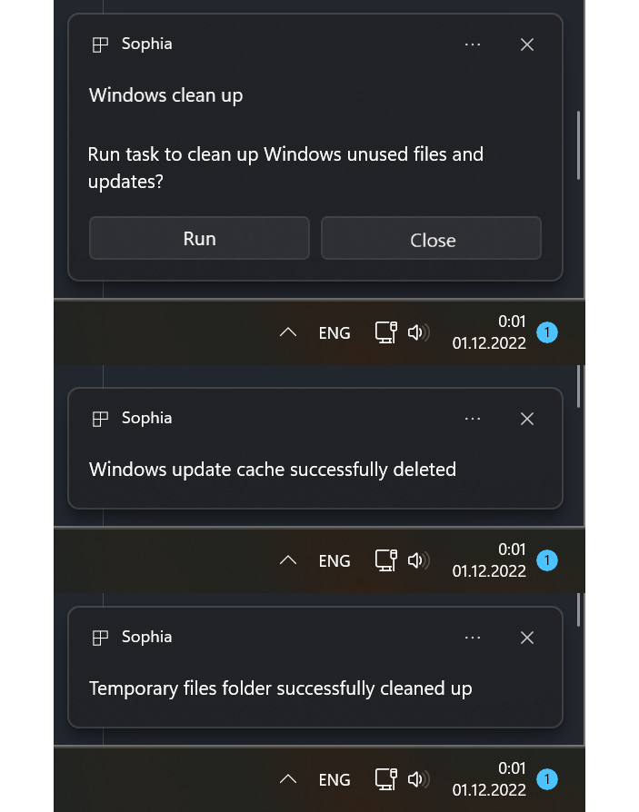
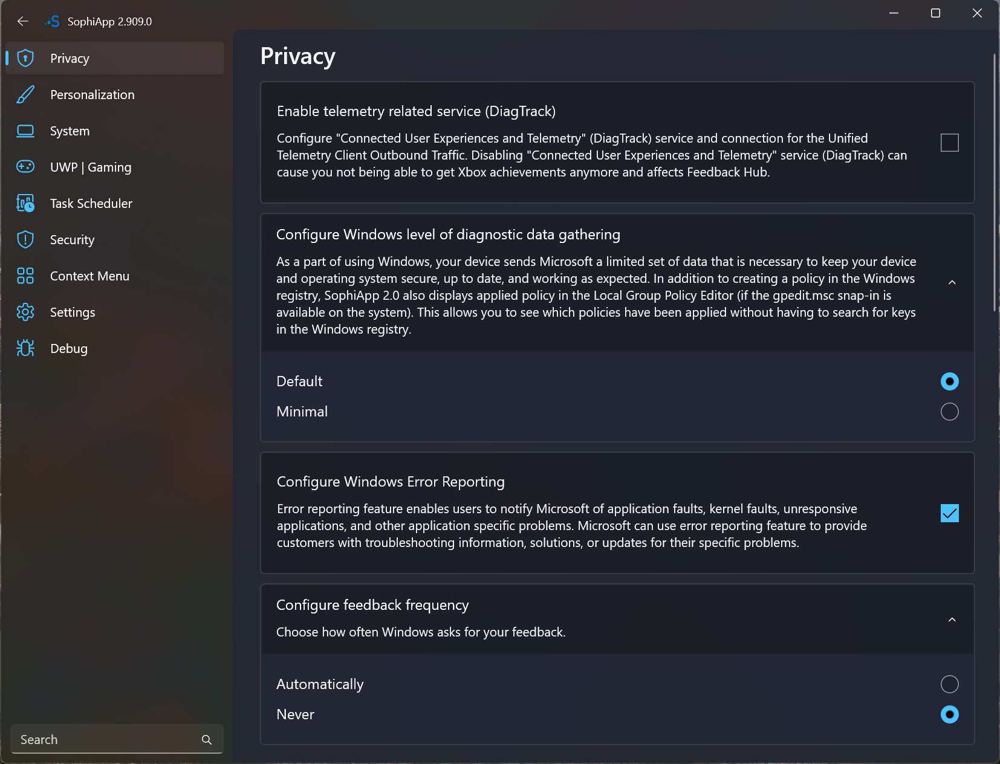
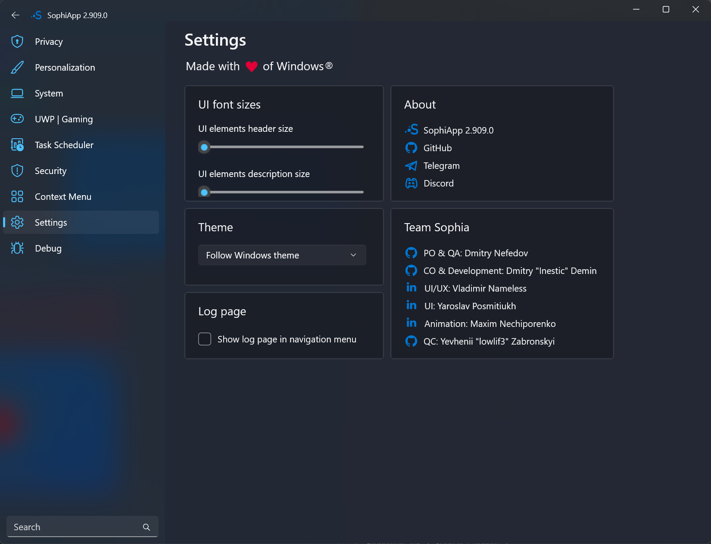

🌐 [English](/README.md) | [Deutsch](/README_de-de.md) | [Русский](/README_ru-ru.md) | [Українська](/README_uk-ua.md)

<div align="center">


# Sophia Script for Windows

Das leistungsstärkste PowerShell-Modul zur Feinabstimmung von Windows auf GitHub

Mit  zu Windows hergestellt

<kbd>
	<a href="https://github.com/farag2/Sophia-Script-for-Windows/actions">
		<picture>
			<source media="(prefers-color-scheme: dark)" srcset="https://shieldcn.dev/github/ci/farag2/Sophia-Script-for-Windows.svg?workflow=Sophia.yml&amp;label=build&amp;variant=outline&amp;size=sm&amp;mode=dark">
			
		</picture>
	</a>
</kbd>
<kbd>
	<a href="https://github.com/farag2/Sophia-Script-for-Windows/releases/latest">
		<picture>
			<source media="(prefers-color-scheme: dark)" srcset="https://shieldcn.dev/badge/Human%20Coded.svg?variant=outline&amp;size=sm&amp;mode=dark&amp;logo=false">
			
		</picture>
	</a>
</kbd>
<kbd>
	<a href="https://github.com/farag2/Sophia-Script-for-Windows/releases/latest">
		<picture>
			<source media="(prefers-color-scheme: dark)" srcset="https://shieldcn.dev/badge/Since%202014.svg?variant=outline&amp;size=sm&amp;mode=dark&amp;logo=false">
			
		</picture>
	</a>
</kbd>

<br>

<kbd>
	<a href="https://github.com/farag2/Sophia-Script-for-Windows/blob/main/.github/workflows/Badge_downloads.yml">
		<picture>
			<source media="(prefers-color-scheme: dark)" srcset="https://shieldcn.dev/badge/dynamic/json.svg?url=https://gist.githubusercontent.com/farag2/25ddc72387f298503b752ad5b8d16eed/raw/SophiaScriptDownloadsCount.json&amp;query=%24.message&amp;label=Downloads&amp;logo=github&amp;variant=outline&amp;size=sm&amp;mode=dark">
			
		</picture>
	</a>
</kbd>
<kbd>
	<a href="https://github.com/farag2/Sophia-Script-for-Windows/blob/main/.github/workflows/Badge_lines.yml">
		<picture>
			<source media="(prefers-color-scheme: dark)" srcset="https://shieldcn.dev/badge/dynamic/json.svg?url=https://gist.githubusercontent.com/farag2/9852d6b9569a91bf69ceba8a94cc97f4/raw/SophiaScript.json&amp;query=%24.message&amp;label=Lines%20of%20Code&amp;logo=github&amp;variant=outline&amp;size=sm&amp;mode=dark">
			
		</picture>
	</a>
</kbd>

<br>

<kbd>
	<a href="https://t.me/sophianews">
		<picture>
			<source media="(prefers-color-scheme: dark)" srcset="https://shieldcn.dev/badge/Sophia%20News.svg?logo=telegram&amp;variant=outline&amp;size=sm&amp;mode=dark">
			
		</picture>
	</a>
</kbd>
<kbd>
	<a href="https://t.me/sophia_chat">
		<picture>
			<source media="(prefers-color-scheme: dark)" srcset="https://shieldcn.dev/badge/Sophia%20Chat.svg?logo=telegram&amp;variant=outline&amp;size=sm&amp;mode=dark">
			
		</picture>
	</a>
</kbd>
<kbd>
	<a href="https://discord.gg/sSryhaEv79">
		<picture>
			<source media="(prefers-color-scheme: dark)" srcset="https://shieldcn.dev/badge/Discord.svg?logo=discord&amp;variant=outline&amp;size=sm&amp;mode=dark">
			
		</picture>
	</a>
</kbd>

<br>
<br>

<kbd>
	<a href="https://github.com/farag2/Sophia-Script-for-Windows/releases/latest">
		<picture>
			<source media="(prefers-color-scheme: dark)" srcset="https://shieldcn.dev/badge/Download.svg?logo=download&amp;variant=outline&amp;size=sm&amp;mode=dark">
			
		</picture>
	</a>
</kbd>

<br>
<br>



<a href="https://trendshift.io/repositories/17603"></a><a
href="https://trendshift.io/repositories/17603"></a><br><a
href="https://trendshift.io/repositories/17603"></a><a
href="https://trendshift.io/repositories/17603"></a>

</div>

## Hauptfunktionen

* `Sophia Script for Windows` achtet auf die Stabilität Ihres Windows-Systems und informiert Sie, wenn ein Problem festgestellt wird
* Mehr als 150 einzigartige Funktionen zur Konfiguration von Windows unter Verwendung der offiziell von Microsoft dokumentierten Methoden, ohne das System zu beschädigen
  * Für jede Änderung gibt es eine entsprechende Funktion zum Wiederherstellen der Standardeinstellungen
* Windows AI konfigurieren
* Datenschutz, Sicherheit und Personalisierung von Windows konfigurieren
* Vollständig quelloffenes Projekt
  * Alle Archive werden mit [GitHub Actions](https://github.com/farag2/Sophia-Script-for-Windows/actions) erstellt und hochgeladen
* Verfügbar über Scoop, Chocolatey und WinGet
* Arm64-Unterstützung
* PowerShell 7-Unterstützung
* Kompatibel mit [VAC](https://help.steampowered.com/faqs/view/571A-97DA-70E9-FF74#whatisvac)
* UWP-Apps deinstallieren, mit Anzeige der lokalisierten Paketnamen
  * Die Liste der installierten UWP-Apps wird [dynamisch](#screenshots) erstellt
* Angewandte Registrierungsrichtlinien werden im Snap-In „Editor für lokale Gruppenrichtlinien“ (gpedit.msc) angezeigt
* DNS-over-HTTPS aktivieren mit
  * [Cloudflare DNS](https://developers.cloudflare.com/1.1.1.1/setup/windows/)
  * [Google Public DNS](https://developers.google.com/speed/public-dns/docs/using)
  * [Quad9 DNS](https://quad9.net/service/service-addresses-and-features/)
  * [Comss.one DNS](https://www.comss.ru/page.php?id=7315)
  * [AdGuard DNS](https://adguard-dns.io/public-dns.html)
  * [OpenDNS](https://www.cisco.com/c/en/us/support/docs/security/umbrella/224705-configure-dns-over-https-doh-with.html)
* OneDrive entfernen
* Interaktive [Eingabeaufforderungen und Popups](#screenshots)
* <kbd>TAB</kbd>-[Autovervollständigung](#bestimmte-funktionen-ausführen) für Funktionen und ihre Argumente (mit Import-TabCompletion.ps1)
* Speicherort der Benutzerordner (ohne die Benutzerdateien zu verschieben) über ein interaktives Menü ändern
  * Desktop
  * Dokumente
  * Downloads
  * Musik
  * Bilder
  * Videos
* Die kostenlosen Cursor `Windows 11 Cursors Concept v2` (hell und dunkel) von [Jepri Creations](https://www.deviantart.com/jepricreations/art/Windows-11-Cursors-Concept-v2-886489356) im laufenden Betrieb installieren
  * Das Archiv wurde mit der [DeviantArt API](https://github.com/farag2/Sophia-Script-for-Windows/blob/main/.github/workflows/Cursors.yml) in den Ordner [Cursors](https://github.com/farag2/Sophia-Script-for-Windows/tree/main/Cursors) heruntergeladen
* Eine App als Standard für eine bestimmte Dateiendung festlegen, ohne dass das Popup-Fenster `Wie möchten Sie diese Datei öffnen?` angezeigt wird
* Alle Windows-Dateizuordnungen exportieren und importieren. Um die Zuordnungen wiederherzustellen, müssen zuvor alle Apps aus der exportierten JSON-Datei installiert sein
* WSL-Linux-Distributionen über ein [Popup-Fenster](#screenshots) mit verständlichen Distributionsnamen installieren
* Geplante Aufgaben mit einer [nativen Toast-Benachrichtigung](#screenshots) erstellen
  * Geplante Aufgaben `Windows Cleanup` und `Windows Cleanup Notification` zum Bereinigen nicht mehr benötigter Dateien und Windows-Update-Dateien erstellen
  * Geplante Aufgabe `SoftwareDistribution` zur Bereinigung von `%SystemRoot%\SoftwareDistribution\Download` erstellen
  * Geplante Aufgabe `Temp` zur Bereinigung temporärer Ordner und Dateien erstellen
    * `%SystemDrive%\$WinREAgent`
    * `%SystemDrive%\$SysReset`
    * `%SystemDrive%\$Windows.~WS`
    * `%SystemDrive%\$GetCurrent`
    * `%SystemDrive%\ESD`
    * `%SystemDrive%\Intel`
    * `%SystemDrive%\PerfLogs`
    * `%SystemRoot%\ServiceProfiles\NetworkService\AppData\Local\Temp`
    * `%LOCALAPPDATA%\CrashDumps`
    * `%SystemDrive%\Recovery`
    * `%SystemRoot%\System32\config\systemprofile\AppData\Local\tw-*.tmp`
* Neueste Version von Microsoft Visual C++ 2015–2026 x86/x64 installieren
* Neueste Version von .NET Desktop Runtime 8, 9, 10 x64 installieren
* Viele weitere Optimierungen für den Datei-Explorer und das Kontextmenü

## Inhaltsverzeichnis

* [Hauptfunktionen](#hauptfunktionen)
* [Herunterladen](#herunterladen)
* [Verwendung](#verwendung)
  * [Bestimmte Funktionen ausführen](#bestimmte-funktionen-ausführen)
* [Systemanforderungen](#systemanforderungen)
* [Screenshots](#screenshots)
* [Übersetzen](#übersetzen)
* [Medien](#medien)
* [SophiApp 2.0](#sophiapp-20-c--winui-3)

## Herunterladen

### Von der Release-Seite

<table>
  <tr>
    <td align="center">Windows 10</td>
    <td align="center">Windows 11</td>
  </tr>
  <tr>
    <td align="left">
      <a href="https://github.com/farag2/Sophia-Script-for-Windows/releases/latest">
        <picture>
          <source media="(prefers-color-scheme: dark)" srcset="https://shieldcn.dev/badge/PowerShell%205.1.svg?label=Windows%2010%20x64&amp;variant=outline&amp;size=sm&amp;mode=dark">
          
        </picture>
      </a>
    </td>
    <td align="left">
      <a href="https://github.com/farag2/Sophia-Script-for-Windows/releases/latest">
        <picture>
          <source media="(prefers-color-scheme: dark)" srcset="https://shieldcn.dev/badge/PowerShell%205.1.svg?label=Windows%2011&amp;variant=outline&amp;size=sm&amp;mode=dark">
          
        </picture>
      </a>
    </td>
  </tr>
  <tr>
    <td align="left">
      <a href="https://github.com/farag2/Sophia-Script-for-Windows/releases/latest">
        <picture>
          <source media="(prefers-color-scheme: dark)" srcset="https://shieldcn.dev/badge/PowerShell%207.svg?label=Windows%2010%20x64&amp;variant=outline&amp;size=sm&amp;mode=dark">
          
        </picture>
      </a>
    </td>
    <td align="left">
      <a href="https://github.com/farag2/Sophia-Script-for-Windows/releases/latest">
        <picture>
          <source media="(prefers-color-scheme: dark)" srcset="https://shieldcn.dev/badge/PowerShell%207.svg?label=Windows%2011&amp;variant=outline&amp;size=sm&amp;mode=dark">
          
        </picture>
      </a>
    </td>
  </tr>
  <tr>
    <td align="left">
      <a href="https://github.com/farag2/Sophia-Script-for-Windows/releases/latest">
        <picture>
          <source media="(prefers-color-scheme: dark)" srcset="https://shieldcn.dev/badge/LTSC%202019.svg?label=Windows%2010&amp;variant=outline&amp;size=sm&amp;mode=dark">
          
        </picture>
      </a>
    </td>
    <td align="left">
      <a href="https://github.com/farag2/Sophia-Script-for-Windows/releases/latest">
        <picture>
          <source media="(prefers-color-scheme: dark)" srcset="https://shieldcn.dev/badge/PowerShell%205.1.svg?label=Windows%2011%20LTSC%202024&amp;variant=outline&amp;size=sm&amp;mode=dark">
          
        </picture>
      </a>
    </td>
  </tr>
  <tr>
    <td align="left">
      <a href="https://github.com/farag2/Sophia-Script-for-Windows/releases/latest">
        <picture>
          <source media="(prefers-color-scheme: dark)" srcset="https://shieldcn.dev/badge/LTSC%202021.svg?label=Windows%2010&amp;variant=outline&amp;size=sm&amp;mode=dark">
          
        </picture>
      </a>
    </td>
    <td align="left">
      <a href="https://github.com/farag2/Sophia-Script-for-Windows/releases/latest">
        <picture>
          <source media="(prefers-color-scheme: dark)" srcset="https://shieldcn.dev/badge/PowerShell%207.svg?label=Windows%2011%20LTSC%202024&amp;variant=outline&amp;size=sm&amp;mode=dark">
          
        </picture>
      </a>
    </td>
  </tr>
  <tr>
    <td></td>
    <td align="left">
      <a href="https://github.com/farag2/Sophia-Script-for-Windows/releases/latest">
        <picture>
          <source media="(prefers-color-scheme: dark)" srcset="https://shieldcn.dev/badge/PowerShell%205.1.svg?label=Windows%2011%20Arm&amp;variant=outline&amp;size=sm&amp;mode=dark">
          
        </picture>
      </a>
    </td>
  </tr>
  <tr>
    <td></td>
    <td align="left">
      <a href="https://github.com/farag2/Sophia-Script-for-Windows/releases/latest">
        <picture>
          <source media="(prefers-color-scheme: dark)" srcset="https://shieldcn.dev/badge/PowerShell%207.svg?label=Windows%2011%20Arm&amp;variant=outline&amp;size=sm&amp;mode=dark">
          
        </picture>
      </a>
    </td>
  </tr>
</table>

### Herunterladen über PowerShell

Laden Sie die neueste Version von `Sophia Script for Windows` entsprechend Ihrer Windows- und PowerShell-Version herunter und entpacken Sie sie in den Ordner Downloads.

```powershell
iwr script.sophia.team -useb | iex
```

Laden Sie die neueste Version von `Sophia Script for Windows` aus dem letzten [Commit](https://github.com/farag2/Sophia-Script-for-Windows/commits/main/) entsprechend Ihrer Windows- und PowerShell-Version herunter und entpacken Sie sie in den Ordner Downloads.

```powershell
iwr sl.sophia.team -useb | iex
```

### Chocolatey

Laden Sie die neueste Version von `Sophia Script for Windows` entsprechend Ihrer Windows-Version herunter und entpacken Sie sie in den Ordner Downloads.

```powershell
choco install sophia --force --yes
```

Laden Sie die neueste Version von `Sophia Script for Windows` für PowerShell 7 entsprechend Ihrer Windows-Version herunter und entpacken Sie sie in den Ordner Downloads.

```powershell
choco install sophia --params "/PS7" --force --yes
```

```powershell
# Deinstallieren Sie die Anwendung und löschen Sie anschließend den heruntergeladenen Ordner manuell
choco uninstall sophia --force --yes
```

### WinGet

Laden Sie die neueste Version von `Sophia Script for Windows` für Windows 11 und PowerShell 5.1 (SFX-Archiv `sophiascript.exe`) herunter und entpacken Sie sie in den Ordner Downloads.

```powershell
$DownloadsFolder = Get-ItemPropertyValue -Path "HKCU:\Software\Microsoft\Windows\CurrentVersion\Explorer\User Shell Folders" -Name "{374DE290-123F-4565-9164-39C4925E467B}"
winget install --id TeamSophia.SophiaScript --location $DownloadsFolder --accept-source-agreements --force

& "$DownloadsFolder\sophiascript.exe"; Start-Sleep -Seconds 3; Remove-Item -Path "$DownloadsFolder\sophiascript.exe" -Force
```

```powershell
# Sophia Script for Windows deinstallieren
winget uninstall --id TeamSophia.SophiaScript --force
```

### Scoop

Laden Sie die neueste Version von `Sophia Script for Windows` für Windows 11 und PowerShell 5.1 herunter und entpacken Sie sie in den Ordner Downloads.

```powershell
# scoop bucket rm extras
scoop bucket add extras
scoop install sophia-script --no-cache
```

```powershell
# Sophia Script for Windows deinstallieren
scoop uninstall sophia-script --purge
```

## Verwendung

<https://github.com/user-attachments/assets/5af5c234-5fb5-4e7e-a3d0-ae496a89e6ba>

* Laden Sie das Archiv für Ihr System herunter und entpacken Sie es
* Öffnen Sie die Datei `Sophia.ps1` und wählen Sie die Funktionen aus, die ausgeführt werden sollen
  * Setzen Sie das `#`-Zeichen vor die Funktion, wenn Sie nicht möchten, dass sie ausgeführt wird
  * Entfernen Sie das `#`-Zeichen vor der Funktion, wenn sie ausgeführt werden soll
* Kopieren Sie den Pfad zum entpackten Ordner `Sophia Script for Windows`
* Klicken Sie mit der rechten Maustaste auf die Schaltfläche `Start`, öffnen Sie das Terminal (PowerShell) als Administrator und wechseln Sie in den kopierten Ordner

```powershell
cd pfad\zum\ordner
```

* Legen Sie die Ausführungsrichtlinie so fest, dass Skripte nur in der aktuellen PowerShell-Sitzung ausgeführt werden können

```powershell
Set-ExecutionPolicy -ExecutionPolicy Bypass -Scope Process -Force
```

* Geben Sie `.\Sophia.ps1` ein und drücken Sie <kbd>Enter</kbd>

### Bestimmte Funktionen ausführen

<https://github.com/user-attachments/assets/d70150d6-af8c-4933-9ec5-b2cf3bb1dd34>

* Führen Sie die Schritte aus dem Abschnitt [Verwendung](#verwendung) bis einschließlich zum Festlegen der Ausführungsrichtlinie aus, ohne `Sophia.ps1` zu starten
* Laden Sie zuerst die Datei `Import-TabCompletion.ps1` per [Dot-Sourcing](https://learn.microsoft.com/en-us/powershell/module/microsoft.powershell.core/about/about_operators#dot-sourcing-operator-):

```powershell
# Mit einem Punkt am Anfang
. .\Import-TabCompletion.ps1
```

* Rufen Sie beliebige Skriptfunktionen mit Namensvervollständigung über die <kbd>TAB</kbd>-Taste auf

```powershell
Sophia -Functions<TAB>
Sophia -Functions temp<TAB>
Sophia -Functions unin<TAB>
Sophia -Functions uwp<TAB>
Sophia -Functions "DiagTrackService -Disable", "DiagnosticDataLevel -Minimal", Uninstall-UWPApps

Sophia -Functions Uninstall-UWPApps, "PinToStart -UnpinAll"
```

## Systemanforderungen

[Windows-10]: https://support.microsoft.com/topic/windows-10-update-history-8127c2c6-6edf-4fdf-8b9f-0f7be1ef3562
[Windows-10-LTSC-2019]: https://support.microsoft.com/topic/windows-10-and-windows-server-2019-update-history-725fc2e1-4443-6831-a5ca-51ff5cbcb059
[Windows-10-LTSC-2021]: https://support.microsoft.com/topic/windows-10-update-history-857b8ccb-71e4-49e5-b3f6-7073197d98fb
[Windows-11-LTSC-2024]: https://support.microsoft.com/topic/windows-11-version-24h2-update-history-0929c747-1815-4543-8461-0160d16f15e5
[Windows-11-25h2]: https://support.microsoft.com/topic/windows-11-version-25h2-update-history-99c7f493-df2a-4832-bd2d-6706baa0dec0

|               Version                    |                Build                             |      Edition        |
|:-----------------------------------------|:------------------------------------------------:|:-------------------:|
| Windows 11 25H2+                         | [Aktuelle stabile Version][Windows-11-25h2]      | Home/Pro/Enterprise |
| Windows 10 x64 22H2                      | [Aktuelle stabile Version][Windows-10]           | Home/Pro/Enterprise |
| Windows 11 Enterprise LTSC 2024          | [Aktuelle stabile Version][Windows-11-LTSC-2024] | Enterprise          |
| Windows 10 21H2 Enterprise LTSC 2021     | [Aktuelle stabile Version][Windows-10-LTSC-2021] | Enterprise          |
| Windows 10 x64 1809 Enterprise LTSC 2019 | [Aktuelle stabile Version][Windows-10-LTSC-2019] | Enterprise          |

## Screenshots

<table>
  <tr>
    <td align="center">
      <br>
      <sub>UWP-Apps</sub>
    </td>
    <td align="center">
      <br>
      <sub>Geplante Aufgaben</sub>
    </td>
  </tr>
  <tr>
    <td align="center">
      <br>
      <sub>WSL</sub>
    </td>
    <td align="center">
      <br>
      <sub>Toast-Benachrichtigungen</sub>
    </td>
  </tr>
</table>

## Übersetzen

* Führen Sie `$PSUICulture` in PowerShell aus, um Ihre UI-Sprache zu ermitteln
* Erstellen Sie einen Ordner mit dem Namen der UI-Sprache (z. B. `de-DE`)
* Legen Sie Ihre lokalisierte Datei `SophiaScript.psd1` in diesem Ordner ab

## Medien

<details>
<summary>Artikel und Erwähnungen</summary>

* [Comss.ru](https://www.comss.ru/page.php?id=19917)
* [Windows Central](https://www.windowscentral.com/microsoft/windows-11/how-to-fine-tune-your-pc-with-the-sophia-script-for-windows-11)
* [XDA](https://www.xda-developers.com/sophia-script-returns-control-windows-11)
* [Neowin](https://www.neowin.net/news/this-script-is-the-ultimate-tool-to-control-and-customize-windows-11)
* [Neowin 2](https://www.neowin.net/news/this-windows-10-setup-script-lets-you-fine-tune-around-150-functions-for-new-installs)
* [4sysops](https://4sysops.com/archives/windows-10-sophia-script-powershell-functions-for-windows-10-fine-tuning-and-automating-routine-configuration-tasks/)
* [gHacks](https://www.ghacks.net/2020/09/27/windows-10-setup-script-has-a-new-name-and-is-now-easier-to-use/)
* [Comss.ru 2](https://www.comss.ru/page.php?id=8019)
* [Habr](https://habr.com/company/skillfactory/blog/553800)
* [Deskmodder.de](https://www.deskmodder.de/blog/2021/08/07/sophia-script-for-windows-jetzt-fuer-windows-11-und-10/)
* [Ru-Board](https://forum.ru-board.com/topic.cgi?forum=62&topic=30617#15)
* [rutracker](https://rutracker.org/forum/viewtopic.php?t=5996011)
* [My Digital Life](https://forums.mydigitallife.net/threads/powershell-windows-10-sophia-script.81675/)

</details>

***

## SophiApp 2.0 (C# + WinUI 3)

[SophiApp 2.0](https://github.com/Sophia-Community/SophiApp) befindet sich in aktiver Entwicklung. 🚀



